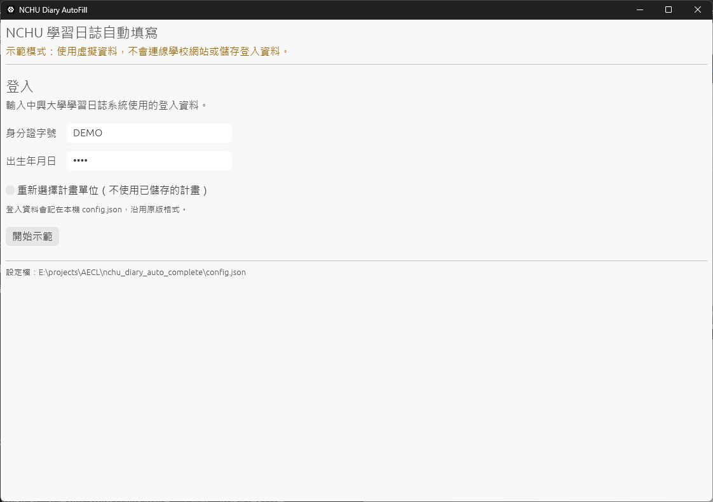
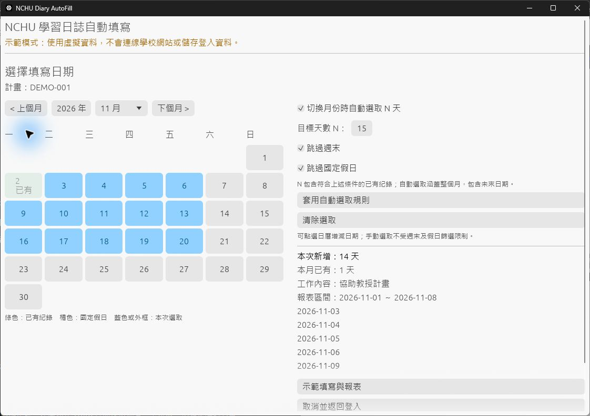

# NCHU Learning Log Automator — Rust

中興大學學習日誌自動填寫工具。使用 Rust、egui/eframe 與 thirtyfour 製作桌面介面及瀏覽器自動化，執行時不需要 Python。

## 功能

- 圖形化登入，記住身分證字號、出生年月日及計畫單位。
- 相容原 Python 版的 `config.json`（`id`、`pw`、`school_value`），保留未知設定欄位。
- 多個計畫時可選擇校內編號；單一計畫自動選取，已失效的設定會要求重選。
- 可跨月、跨年切換的日期多選日曆，預設自動選取 15 天，可排除週末與臺灣國定假日；今天之後的月份與日期強制停用。
- 已有且符合篩選條件的日誌計入 N 天，只送出尚未填寫的日期。
- 依序嘗試 Edge、Chrome、Firefox，自動下載符合瀏覽器版本的 WebDriver。
- 工作內容沿用「協助教授計畫」。送出前重新讀取紀錄，每筆送出前重新確認校內編號、送出後確認表格更新；失敗時停止，不自動重試送出。
- 完成後開啟「學習日誌列印」：當月查詢 1 日到今天，其他月份查詢整月。
- 沒有選取新增日期時可直接查詢報表。報表開啟後保留瀏覽器供人工確認，關閉瀏覽器後程式結束。
- 瀏覽器操作期間，主程式縮成左上角的置頂狀態窗，持續顯示進度與取消按鈕；需要使用者選擇時會自動恢復完整視窗。
- Windows release 執行檔使用 GUI 子系統，雙擊啟動不會另外開啟終端機視窗。

週末及假日篩選只影響自動選取；今天以前的日期仍可手動增減。未來日期同時由介面、日期驗證與瀏覽器送出層攔截。

## 開發與執行

需要 **Rust 1.99 以上**，以及 Edge、Chrome、Firefox 至少一種瀏覽器。首次建置需要網路下載 Cargo 套件，首次啟動瀏覽器需要下載 WebDriver。

```sh
cargo run --locked
```

Windows 可使用現有 `stable-x86_64-pc-windows-gnu` 工具鏈，需讓 MinGW-w64 的 `gcc` 可在 PATH 找到；也可使用 MSVC 工具鏈搭配 Visual Studio C++ Build Tools。專案將 Cargo 並行工作數設為 2，避免 GUI 依賴編譯時耗盡記憶體。

Ubuntu / Debian 建置前安裝桌面與系統 TLS 開發套件；顯示中文需有 CJK 字型：

```sh
sudo apt-get update
sudo apt-get install -y build-essential pkg-config libssl-dev libfontconfig1-dev libxkbcommon-dev libwayland-dev libx11-dev libxi-dev libxrandr-dev libxcursor-dev libxinerama-dev libxcb-shape0-dev libxcb-xfixes0-dev libgl1-mesa-dev fonts-noto-cjk
```

egui 會使用系統字型補上中文字元。macOS 使用系統中文字型與原生 TLS，開發時需有 Xcode Command Line Tools。

### 設定檔

在專案根目錄使用 `cargo run` 時，讀寫根目錄的 `config.json`；散佈執行檔則預設使用執行檔旁的檔案。可以明確指定路徑：

```sh
cargo run --locked -- --config "path/to/config.json"
```

將舊版 `config.json` 放在上述位置即可沿用。登入資料以明文儲存在本機，設定檔已列入 `.gitignore`。格式錯誤時介面會顯示錯誤，修復後可重新讀取。

### 離線示範

```sh
cargo run --locked -- --demo
```

示範模式預填虛擬帳密及兩個計畫，可以操作登入、計畫選擇、日曆及完成畫面；不連線學校網站、不寫設定檔，也不會新增真實日誌。

### 使用流程

1. 輸入身分證字號及出生年月日（例如 `900928`），需要換計畫時勾選「重新選擇計畫單位」。
2. 登入後如有多個計畫，選擇要填寫的校內編號。
3. 選擇月份，調整 N 天與篩選條件，按「套用自動選取規則」，或直接點選日曆增減日期。綠色日期表示此計畫已有紀錄。
4. 確認選取日期及報表區間後按「確認並送出」。沒有新日期時可按「僅開啟報表」。
5. 在瀏覽器確認日誌及列印報表，完成後關閉瀏覽器。

以下為離線示範模式的實際畫面：





## 測試

```sh
cargo fmt --check
cargo clippy --locked --all-targets -- -D warnings
cargo test --locked
```

單元測試涵蓋民國日期、日期驗證、已有紀錄計數、假日/週末篩選、農曆跨年、閏年報表、設定檔相容讀寫及計畫選擇。

實際瀏覽器整合測試預設略過，需額外執行：

```sh
cargo test --locked --test browser_flow -- --ignored
```

這項測試使用 headless 瀏覽器及 `127.0.0.1` 本機測試網頁，驗證登入、iframe、計畫切換後才讀取紀錄、避免重複、固定工作內容、送出確認及報表日期，**不連線中興大學網站**。預設使用 Edge；可透過 `NCHU_TEST_BROWSER=Chrome` 或 `Firefox` 更換瀏覽器。Windows PowerShell 範例：

```powershell
$env:NCHU_TEST_BROWSER = "Chrome"
cargo test --locked --test browser_flow -- --ignored
```

`NCHU_DRIVER_CACHE` 可覆寫 thirtyfour 的預設系統驅動快取目錄。

## 建置與發佈

```sh
cargo build --release --locked
```

Windows 產物為 `target/release/nchu-diary-autofill.exe`；macOS / Linux 為 `target/release/nchu-diary-autofill`。執行時仍需已安裝的瀏覽器及相容的系統圖形函式庫。

`.github/workflows/build.yml` 會在 PR 與推送時執行 Rust 檢查，並於 Windows、macOS、Linux 建置。推送 `v*` tag 時會將各平台產物附加至 GitHub Release；手動執行 workflow 可下載建置 artifacts。

## 程式結構

```text
src/
  main.rs       程式入口、命令列參數、桌面視窗
  config.rs     舊版設定相容、讀寫及路徑
  dates.rs      日期規則、民國日期、臺灣假日、報表區間
  browser.rs    WebDriver、登入、計畫切換、填寫及報表
  worker.rs     背景執行緒、命令與事件、取消及清理
  gui.rs        登入、計畫選擇、多選日曆與進度畫面
data/
  taiwan_holidays.json
tests/
  browser_flow.rs
  fixtures/     本機整合測試網頁
```

若從 C/C++ 開始學 Rust，可先讀不依賴 GUI 的 `dates.rs`，接著看 `config.rs` 的 `Result` 與序列化，再看 `worker.rs` 的 enum 訊息交換，最後看非同步 WebDriver 操作。

## 臺灣假日資料

內建資料涵蓋 **1912–2099**，由原專案使用的 **python-holidays 0.58** 匯出，沿用其 `Taiwan`、預設 PUBLIC 類別及補假規則；Rust 執行時不會呼叫 Python，也不需要連線假日服務。

這是原版資料的快照，未自動套用後續假日規則變更。需要更新時應以新版 python-holidays 的相同設定重新產生資料、更新來源版本，並重跑日期與整合測試。資料來源與授權見 `THIRD_PARTY_NOTICES.md`。
